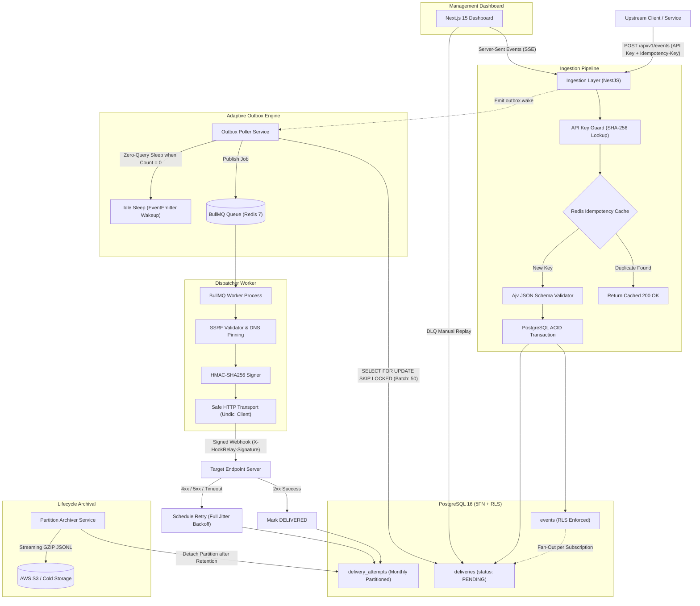
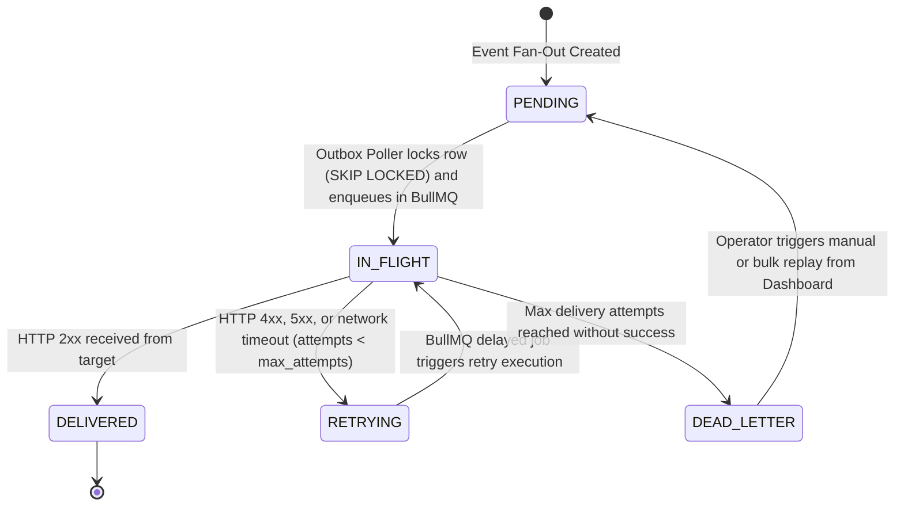
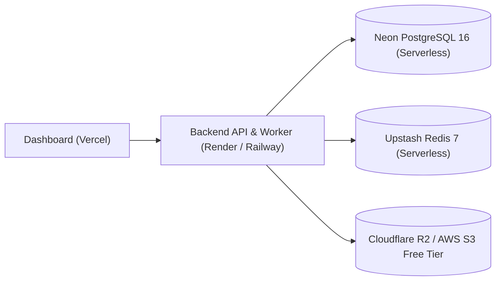
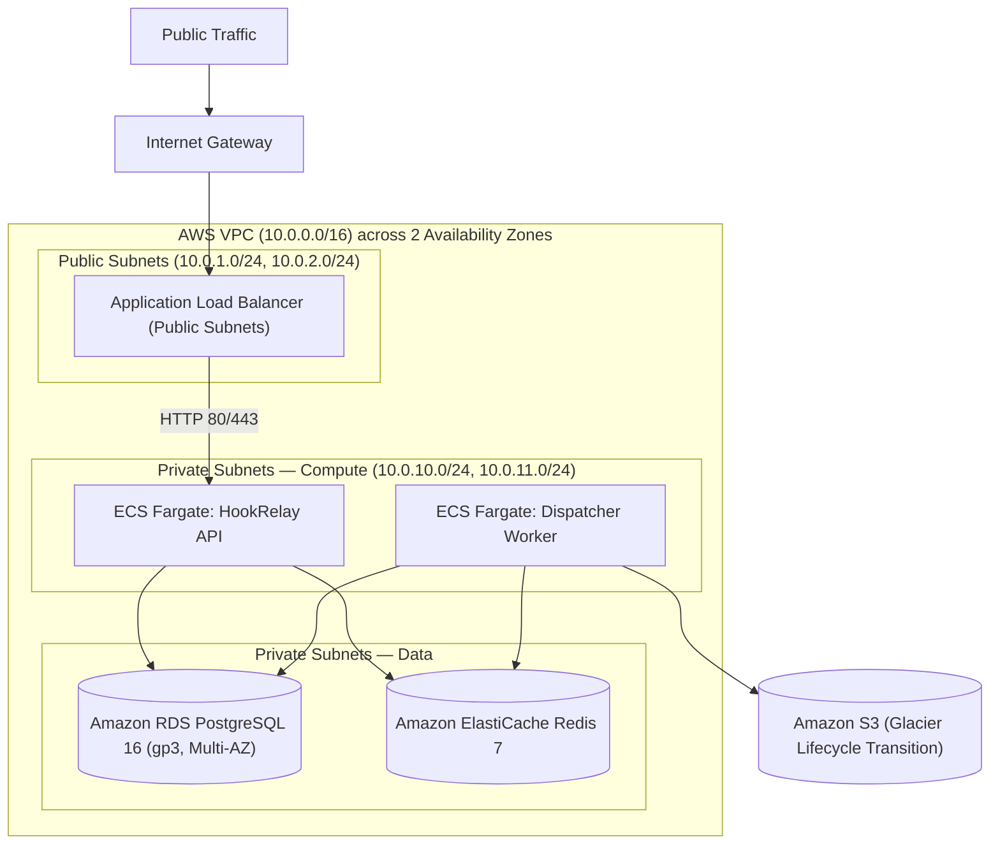

# HookRelay — High-Throughput Event Dispatcher & Reliable Webhook Engine

[](https://github.com/mikaelpizzi/hookrelay/actions/workflows/ci.yml)
[](https://www.typescriptlang.org/)
[](https://nodejs.org/)
[](https://www.postgresql.org/)
[](https://bullmq.io/)
[](https://nextjs.org/)
[](https://www.terraform.io/)
[-brightgreen.svg)]()

HookRelay is a production-grade event dispatcher engine and reliable webhook delivery platform designed for high throughput, strict tenant isolation, and at-least-once delivery semantics. It guarantees reliable delivery through an adaptive transactional outbox pattern, DNS-pinned egress transport with SSRF protection, full-jitter exponential backoff, declarative PostgreSQL monthly partitioning, and cold storage offloading to S3.

---

## Table of Contents

- [System Architecture](#system-architecture)
- [Delivery State Machine](#delivery-state-machine)
- [Architectural Decisions and Trade-offs](#architectural-decisions-and-trade-offs)
  - [1. Modular Monolith vs Microservices](#1-modular-monolith-vs-microservices)
  - [2. PostgreSQL RLS + 5FN vs Soft Multi-Tenancy](#2-postgresql-rls--5fn-vs-soft-multi-tenancy)
  - [3. Transactional Outbox with SKIP LOCKED vs Dual-Write](#3-transactional-outbox-with-skip-locked-vs-dual-write)
  - [4. Backpressure and Load Shedding vs Unbounded Buffering](#4-backpressure-and-load-shedding-vs-unbounded-buffering)
  - [5. DNS-Pinned Egress Client vs Standard HTTP Client](#5-dns-pinned-egress-client-vs-standard-http-client)
  - [6. Full Jitter Exponential Backoff vs Pure Backoff](#6-full-jitter-exponential-backoff-vs-pure-backoff)
  - [7. Tiered Storage (PostgreSQL Partitions to S3 Cold Archive)](#7-tiered-storage-postgresql-partitions-to-s3-cold-archive)
- [Security Model](#security-model)
- [Local Quickstart](#local-quickstart)
- [Verification and Testing](#verification-and-testing)
- [Demo Sandbox Walkthrough](#demo-sandbox-walkthrough)
- [Deployment Topologies](#deployment-topologies)
  - [Free-Tier Cloud Deployment](#free-tier-cloud-deployment)
  - [Production AWS Architecture (Terraform)](#production-aws-architecture-terraform)
- [Monorepo Structure](#monorepo-structure)

---

## System Architecture

HookRelay decouples event ingestion from egress dispatching using an ACID Transactional Outbox and distributed BullMQ queues.



---

## Delivery State Machine

Deliveries advance through strict state transitions governed by database check constraints and worker handlers:



---

## Architectural Decisions and Trade-offs

### 1. Modular Monolith vs Microservices

| Attribute | Modular Monolith (Chosen) | Microservices Architecture |
| :--- | :--- | :--- |
| **Transaction Boundary** | Single atomic database transaction across Events, Subscriptions, and Outbox | Distributed transactions (Sagas, 2PC) with eventual consistency windows |
| **Operational Overhead** | Single container image, unified CI/CD, consolidated logs and metrics | Multiple deployment pipelines, service meshes, distributed tracing |
| **Latency Profile** | In-memory module communication ($< 1$ ms) | Network serialization and HTTP/gRPC hops ($10$-$50$ ms) |
| **Data Coherence** | Foreign keys enforced at database engine level | Cross-service eventual consistency and reconciliation jobs |

**Rationale:** Distributing event ingestion and outbox processing across microservices introduces dual-write failures, serialization latency, and significant operational complexity. A modular monolith provides strict module boundaries within a single codebase while preserving transactional integrity across the ingestion-to-outbox lifecycle.

### 2. PostgreSQL RLS + 5FN vs Soft Multi-Tenancy

| Attribute | PostgreSQL RLS + 5FN (Chosen) | Application-Level Soft Isolation |
| :--- | :--- | :--- |
| **Enforcement Layer** | Database kernel (`SET LOCAL app.current_tenant_id`) | Application query filters (`WHERE tenant_id = ?`) |
| **Leak Risk** | Zero. Bypassing requires explicit superuser or `BYPASSRLS` privileges | High. A single missing `WHERE` clause in ORM queries leaks data |
| **Data Normalization** | 5th Normal Form: zero redundancy, zero update anomalies | Denormalized tables with high risk of desynchronized metadata |
| **Audit Compliance** | Native query-level row authorization audit trails | Relies entirely on application-level access logs |

**Rationale:** Webhook engines process mission-critical, confidential business data across hundreds of tenants. Soft application-level filtering is vulnerable to developer oversight in complex queries. By enforcing kernel-level Row-Level Security policies at the database layer, HookRelay guarantees multi-tenant isolation even in the event of application bugs.

### 3. Transactional Outbox with SKIP LOCKED vs Dual-Write

| Attribute | Transactional Outbox + SKIP LOCKED (Chosen) | Direct Dual-Write (DB + Redis Queue) |
| :--- | :--- | :--- |
| **Consistency Guarantee** | 100% at-least-once delivery. Zero lost events | Vulnerable to network failure between DB commit and Redis publish |
| **Concurrency Safety** | `FOR UPDATE SKIP LOCKED` allows parallel pollers with zero row contention | Requires external locking or suffers race conditions |
| **Resource Efficiency** | Adaptive polling: automatically transitions to 0 queries when outbox is empty | Continuous polling or fragile background event timers |

**Rationale:** Writing to PostgreSQL and immediately publishing to a message broker is a classic distributed systems anti-pattern. If the database commit succeeds but the message broker publish fails, the event is permanently lost. The Transactional Outbox pattern writes the delivery record in the exact same ACID transaction as the ingested event. The poller consumes batches safely using `FOR UPDATE SKIP LOCKED` and enters sleep mode with zero database queries when the queue drains.

### 4. Backpressure and Load Shedding vs Unbounded Buffering

| Attribute | Explicit Backpressure (Chosen) | Unbounded In-Memory Buffering |
| :--- | :--- | :--- |
| **Failure Mode under Surge** | Fast HTTP 429 with `Retry-After` header | Process Out-Of-Memory (OOM) crash and buffer loss |
| **Client Coordination** | Upstream clients throttle ingestion based on server load | Clients continue sending traffic into a failing server |
| **Predictability** | Flat CPU and RAM consumption profiles under stress | Explosive heap expansion leading to event dropouts |

**Rationale:** When incoming traffic exceeds queue processing capacity, unbounded buffering causes heap exhaustion and cascaded crashes. HookRelay monitors queue depth and memory thresholds. Once saturation limits are reached, the ingestion endpoint immediately sheds load with standard HTTP 429 responses, preserving system stability and coordinating retries.

### 5. DNS-Pinned Egress Client vs Standard HTTP Client

| Attribute | DNS-Pinned Undici Client (Chosen) | Standard HTTP Client (`axios` / `fetch`) |
| :--- | :--- | :--- |
| **SSRF Defense** | Validates resolved IPv4/IPv6 against forbidden CIDR ranges | Vulnerable to intranet and cloud metadata endpoint exploitation |
| **DNS Rebinding Defense** | Pre-resolves DNS and binds directly to validated socket IP | Vulnerable. DNS resolves to public IP on check, re-resolves to private IP on connect |
| **Connection Pooling** | Custom `undici.Pool` with TLS certificate validation | Generic connection pooling without IP pinning |

**Rationale:** Standard HTTP clients resolve domain names during socket connection, allowing malicious actors to exploit DNS rebinding attacks: the validation step resolves to a benign public IP, but the actual HTTP request connects to an internal address (such as `169.254.169.254` or `127.0.0.1`). HookRelay utilizes a custom DNS resolver that resolves and validates the target IP against RFC 1918, RFC 3927, and cloud metadata ranges, pinning the TCP socket directly to the validated IP.

### 6. Full Jitter Exponential Backoff vs Pure Backoff

| Attribute | Full Jitter Exponential Backoff (Chosen) | Pure Exponential Backoff |
| :--- | :--- | :--- |
| **Thundering Herd** | Mitigated. Retry requests are spread uniformly over time | Severe. Retries fire simultaneously in synchronized waves |
| **Downstream Recovery** | Smooth traffic arrival rate gives downstream service room to recover | Downstream server is repeatedly overwhelmed at each retry interval |
| **Formula** | $t_{wait} = \text{random}(0, \min(T_{max}, T_{base} \cdot 2^{attempt}))$ | $t_{wait} = \min(T_{max}, T_{base} \cdot 2^{attempt})$ |

**Rationale:** Pure exponential backoff synchronizes retry spikes across concurrent failures. When a downstream endpoint experiences an outage, all failed deliveries retry at the exact same moment ($2^n$ seconds later), creating a thundering herd that re-crashes the recovering service. Full jitter distributes retry attempts uniformly across the retry window, smoothing out egress traffic.

### 7. Tiered Storage (PostgreSQL Partitions to S3 Cold Archive)

| Attribute | Tiered Storage Architecture (Chosen) | Monolithic Database Storage |
| :--- | :--- | :--- |
| **Storage Cost** | Reduced by over 90% (S3 Infrequent Access / Glacier) | High database EBS/gp3 storage and IOPS cost |
| **Query Performance** | Fast indexing and sequential scans on small active partitions | Degraded query performance as indexes exceed RAM working set |
| **Partition Maintenance** | Zero-downtime `ALTER TABLE DETACH PARTITION CONCURRENTLY` | Costly `DELETE FROM` queries causing table bloat and lock contention |

**Rationale:** Storing millions of historical delivery attempts in hot PostgreSQL storage degrades vacuum operations, bloats B-tree indexes, and drives up cloud database costs. HookRelay declutters operational storage using monthly declarative partitions. Partitions outside the active retention window are concurrently detached, streamed into compressed GZIP JSONL objects on S3, and cleanly dropped with zero table bloat.

---

## Security Model

1. **HMAC-SHA256 Signatures**: Each egress webhook delivery includes cryptographic authentication headers:
   - `X-HookRelay-Signature`: `sha256=<hex_digest>` computed using the endpoint's secret key.
   - `X-HookRelay-Timestamp`: Unix epoch timestamp to prevent replay attacks.
   - Verified via `crypto.timingSafeEqual` to eliminate timing attack vectors.
2. **Anti-SSRF and Network Isolation**:
   - Outbound requests to private subnets (RFC 1918: `10.0.0.0/8`, `172.16.0.0/12`, `192.168.0.0/16`), loopback (`127.0.0.0/8`), link-local (`169.254.0.0/16`), and carrier-grade NAT are blocked.
   - Custom socket dispatcher prevents DNS rebinding by pinning connections to verified IP addresses.
3. **API Key Authentication**:
   - API keys utilize high-entropy random bytes with environment-specific prefixes (`hr_live_...` or `hr_test_...`).
   - Keys are stored exclusively as SHA-256 hashes (`key_hash`). Plaintext keys are never stored or logged.

---

## Local Quickstart

### Prerequisites

- Node.js 20 LTS or later
- Docker 24+ and Docker Compose
- npm 10+

### 1. Clone and Install Dependencies

```bash
git clone https://github.com/mikaelpizzi/hookrelay.git
cd hookrelay
npm install
```

### 2. Start Infrastructure Services

Spin up PostgreSQL 16, Redis 7, and the local AWS emulator:

```bash
docker compose up -d
```

Verify service status:

```bash
docker compose ps
```

### 3. Initialize Database Schema and Seed Data

Apply the PostgreSQL schema and seed the default `Demo Corp` tenant with production and sandbox credentials:

```bash
npm run seed
```

### 4. Start Application Services

Start the backend API and worker engine:

```bash
npm run start:api
```

In a separate terminal, start the Next.js management dashboard:

```bash
npm run start:dashboard
```

The API will be available at `http://localhost:3000` and the Dashboard at `http://localhost:3001`.

---

## Verification and Testing

### Health Check

Verify the API status:

```bash
curl -s http://localhost:3000/health
```

Expected response:
```json
{"status":"ok","timestamp":"2026-11-15T12:00:00.000Z"}
```

### Event Ingestion

Ingest an event using the pre-seeded `Demo Corp` production key:

```bash
curl -X POST http://localhost:3000/api/v1/events \
  -H "Content-Type: application/json" \
  -H "X-API-Key: hr_live_demo_corp_00000000000000000000000000000000" \
  -H "X-Idempotency-Key: idemp-order-1001" \
  -d '{
    "topic": "order.created",
    "payload": {
      "orderId": "ord_99812",
      "amount": 25000,
      "currency": "USD",
      "customer": {
        "id": "cust_441",
        "email": "customer@example.com"
      }
    }
  }'
```

Expected response:
```json
{
  "eventId": "3fa85f64-5717-4562-b3fc-2c963f66afa6",
  "status": "ACCEPTED",
  "deliveriesCreated": 1
}
```

### Live Demo Webhook Sink

HookRelay includes a built-in mock endpoint for end-to-end delivery testing:

```bash
curl -X POST http://localhost:3000/api/v1/demo/sink \
  -H "Content-Type: application/json" \
  -H "X-HookRelay-Signature: sha256=abcdef..." \
  -H "X-HookRelay-Timestamp: 1731672000" \
  -d '{"event":"test"}'
```

### Query Deliveries

Inspect delivery statuses and attempt logs:

```bash
curl -s http://localhost:3000/api/v1/deliveries \
  -H "X-API-Key: hr_live_demo_corp_00000000000000000000000000000000"
```

---

## Demo Sandbox Walkthrough

The platform includes a pre-configured multi-tenant environment ready for exploration:

| Property | Value |
| :--- | :--- |
| **Tenant Name** | `Demo Corp` |
| **Tenant Slug** | `demo-corp` |
| **Production API Key** | `hr_live_demo_corp_00000000000000000000000000000000` |
| **Sandbox API Key** | `hr_test_demo_corp_00000000000000000000000000000000` |
| **Pre-configured Topics** | `order.created`, `payment.succeeded`, `invoice.paid` |
| **Dashboard URL** | `http://localhost:3001` |

### Dashboard Features

1. **Deliveries Explorer**: Real-time delivery tracking with status filters (`PENDING`, `IN_FLIGHT`, `DELIVERED`, `RETRYING`, `DEAD_LETTER`).
2. **Attempt Inspection**: Detailed HTTP latency metrics, response codes, and signed payload headers for each attempt.
3. **Dead-Letter Queue (DLQ) Replay**: One-click manual replay and bulk replay capabilities for failed deliveries.
4. **Live SSE Stream**: Real-time Server-Sent Events stream visualizing delivery lifecycle events without polling.

---

## Deployment Topologies

### Free-Tier Cloud Deployment

For cost-free cloud hosting and staging deployments:



- **PostgreSQL**: Neon Serverless PostgreSQL 16 (Free 0.5 GB storage, supports RLS and partitions).
- **Redis**: Upstash Redis (Free 10,000 commands/day, persistent REST/TCP connection).
- **Backend**: Render Web Service or Railway Free Plan (Containerized NestJS API and Worker).
- **Frontend**: Vercel (Edge-optimized Next.js App Router hosting).
- **Cold Storage**: Cloudflare R2 (10 GB free storage, zero egress fees) or AWS S3 Standard Free Tier.

### Production AWS Architecture (Terraform)

HookRelay includes complete, modular Terraform definitions in `infra/terraform/`:



#### Terraform Deployment Commands

```bash
cd infra/terraform
terraform init
terraform plan -out=tfplan
terraform apply tfplan
```

---

## Monorepo Structure

```
segundo-proyecto/
├── apps/
│   ├── api/                     # NestJS Core Engine & Dispatcher Worker
│   │   ├── prisma/              # Database seed script and Prisma client schema
│   │   ├── src/
│   │   │   ├── modules/
│   │   │   │   ├── archiver/    # Monthly partition lifecycle and S3 archiver
│   │   │   │   ├── auth/        # API key verification, SHA-256 lookup, RLS context
│   │   │   │   ├── catalog/     # Event topics and Ajv schema validation
│   │   │   │   ├── deliveries/  # Delivery tracking, attempt logs, DLQ replay
│   │   │   │   ├── demo-sink/   # Built-in live webhook test sink
│   │   │   │   ├── dispatcher/  # Outbox poller, BullMQ worker, HMAC, Undici client
│   │   │   │   ├── endpoints/   # Webhook endpoint management and SSRF validator
│   │   │   │   └── ingest/      # Event ingestion pipeline with Redis idempotency
│   │   │   └── shared/          # Database, Queue, and Logger shared services
│   │   └── test/                # Unit and E2E integration test suites
│   │
│   └── dashboard/               # Next.js 15 Management UI
│       └── src/
│           ├── app/             # App Router pages (deliveries, endpoints, settings)
│           └── components/      # UI components (metrics cards, SSE tables, modals)
│
├── database/
│   └── schema.sql               # PostgreSQL 16 single source of truth (5FN + RLS)
│
├── docker/
│   └── aws-emulator/            # Local AWS S3 emulator container definition
│
├── infra/
│   └── terraform/               # Production AWS ECS, ALB, RDS, ElastiCache, S3 HCL
│
├── .github/
│   └── workflows/
│       └── ci.yml               # GitHub Actions CI pipeline
│
├── docker-compose.yml           # Local development multi-container orchestration
└── package.json                 # Monorepo root workspace definitions
```

---

## Engineering Quality Commands

```bash
# Code Style & Linting
npm run lint

# TypeScript Strict Type Verification
npm run typecheck

# Unit Test Suite (Jest)
npm run test:unit

# E2E & Chaos Integration Tests
npm run test:e2e

# Production Production Build
npm run build
```

---

## License

This project is licensed under the MIT License.
